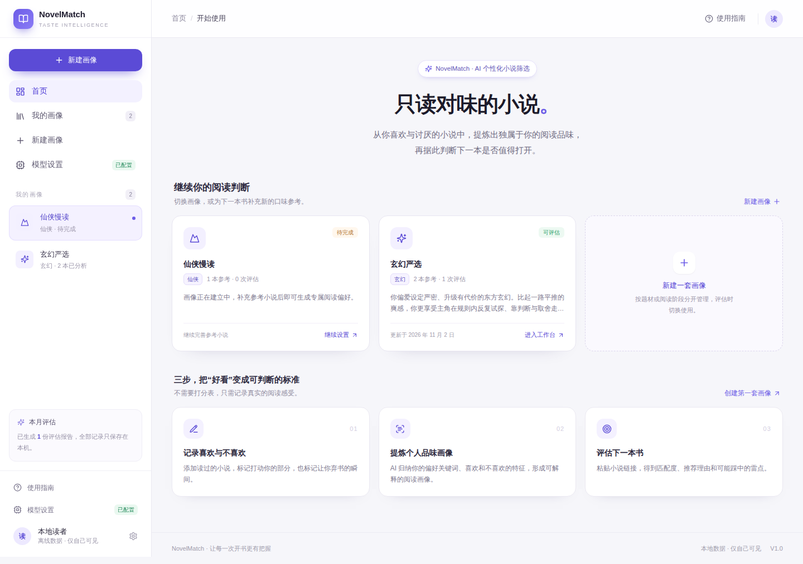
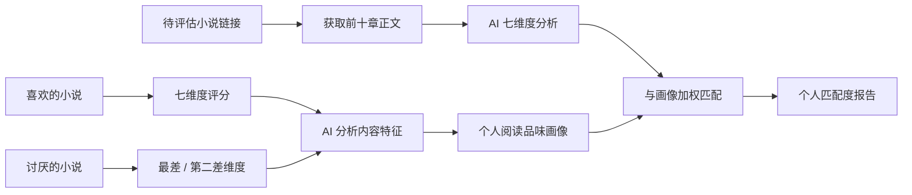
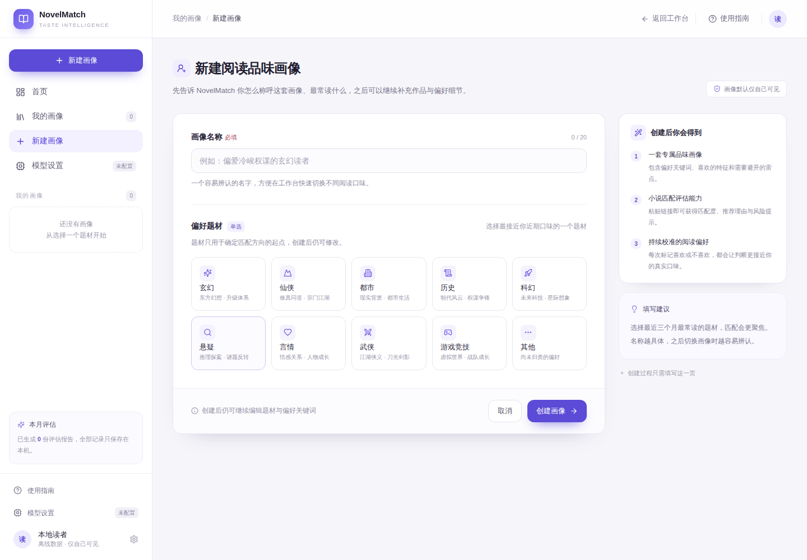
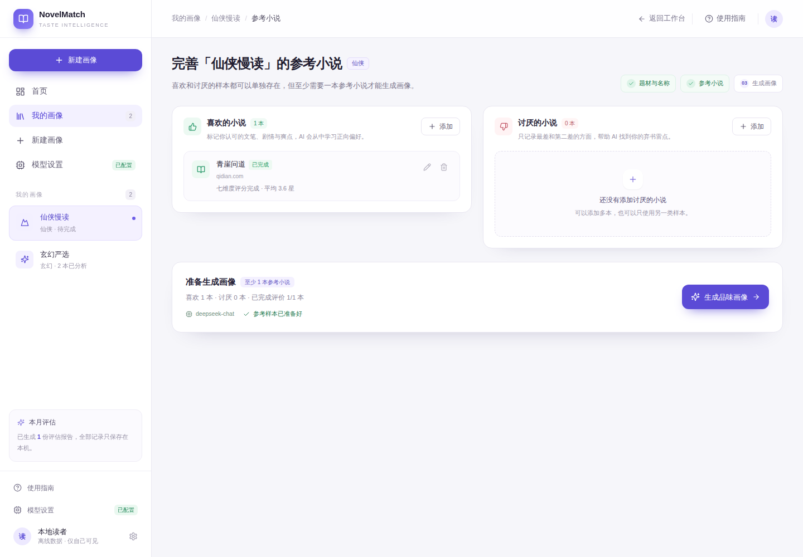
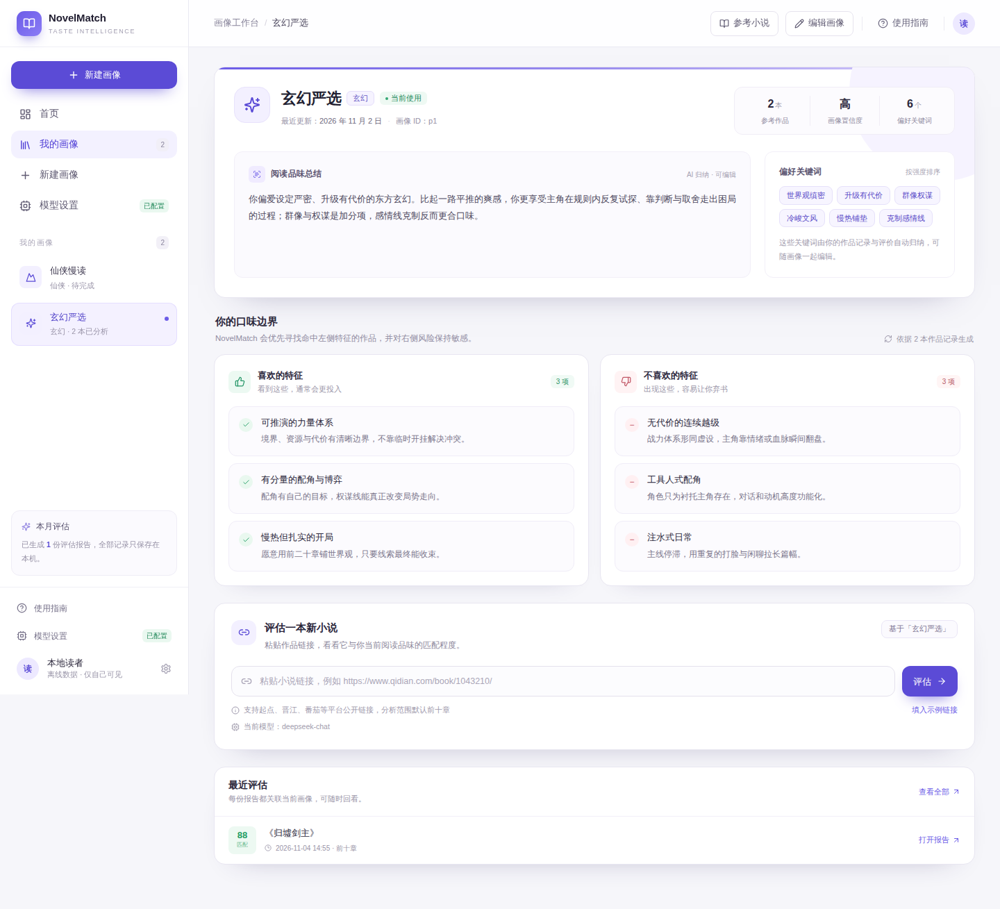
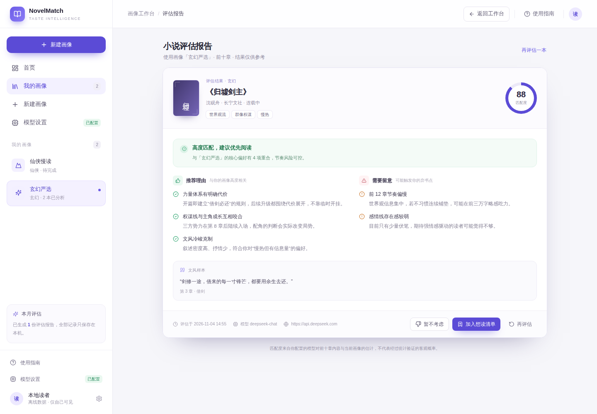
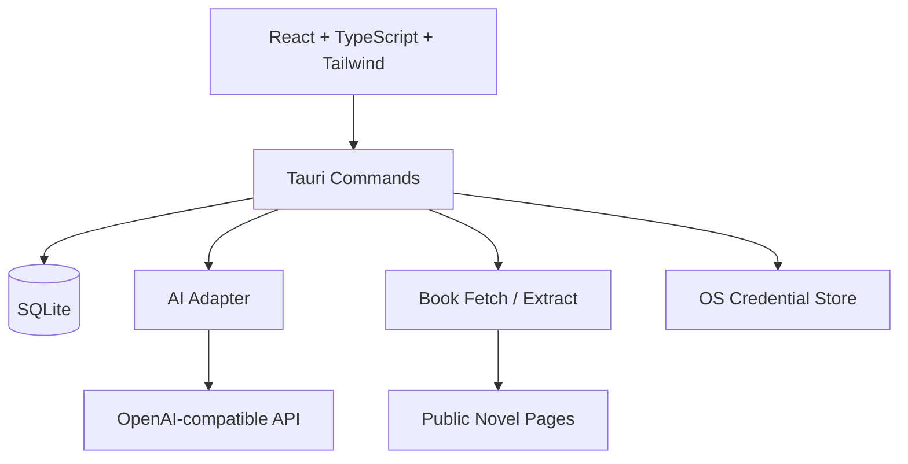

# NovelMatch

> 只读对味的小说。

**NovelMatch** 是一款基于 AI 的个性化小说筛选桌面应用。它不提供统一的大众评分，而是从你喜欢和讨厌的小说中学习个人阅读品味，再分析待选小说的前十章，给出属于你的阅读匹配度。

[产品需求文档](docs/PRD.md) · [技术设计](docs/TECHNICAL_DESIGN.md) · [产品决策记录](docs/PRODUCT_DECISIONS.md) · [交互原型](design/prototype/)



> **项目状态**：V1.0 Windows MVP 可运行；番茄公开页面已验证；起点因访问验证不自动支持。

<p>
  
  
  
  
  
  
</p>

---

## 为什么做这个产品

传统小说评分回答的是「这本书在大多数人眼里怎么样」，但读者真正关心的是：

> 这本书适不适合我？

不同读者对文笔、节奏、人物、世界观和爽点的偏好差异很大。同一本高分作品，有人觉得神作，也有人看三章就弃书。

NovelMatch 的假设是：**用户自己的喜欢与不喜欢，比大众评分更能定义个人阅读品味。**

因此产品采用双向参考样本：

- 喜欢的小说：用户逐项打 1–5 星，学习用户认可的特征。
- 讨厌的小说：用户标出最差和第二差的方面，学习用户敏感的雷点。
- AI 将文本特征与主观评价关联，生成个人阅读画像。
- 评估新书时，结合画像与小说前十章内容，输出个人匹配度。

---

## 产品流程



核心流程：

```text
创建画像 → 选择题材 → 导入正向/负向参考小说 → 完成评价
→ AI 生成品味画像 → 粘贴待评估小说链接 → 五阶段评估 → 匹配度报告
```

---

## 核心功能

### 画像与参考样本

- 多套阅读品味画像管理，支持创建、切换、编辑、删除。
- 预设题材与自定义题材。
- 正向参考小说七维度评分：文笔、剧情、人物塑造、世界观、节奏、创意、爽点。
- 负向参考小说第一差 / 第二差维度选择，两次选择不可重复。
- 参考小说完成状态、评价修改、删除与数量统计。
- 至少一本参考小说才允许生成画像。

### AI 品味画像

- AI 分析参考小说文本特征，并与用户评分、负向排序关联。
- 生成结构化画像：
  - 阅读品味总结
  - 偏好关键词
  - 喜欢的特征
  - 不喜欢的特征
  - 七维度偏好
  - 维度权重与置信度
- 用户可手动修改画像总结与关键词。
- 画像生成过程展示阶段进度，支持取消与失败重试。

### 小说评估

- 输入公开小说链接，抓取前 10 章正文。
- 五阶段进度：获取信息 → 获取正文 → AI 分析 → 匹配画像 → 生成报告。
- AI 返回七维度匹配分与权重，后端按加权公式汇总为最终匹配度。
- 报告包含匹配度、结论、推荐理由、风险提示与文风样本。
- 评估历史记录可回看、删除。
- 正文不完整时明确提示，不伪造完整分析。

### 模型配置

- 严格保留三个配置项：API Key、模型名称、Base URL。
- 兼容 OpenAI Chat Completions 接口，不绑定特定服务商。
- 支持连接测试，并区分 Key 无效、模型不存在、限流、超时、服务异常等错误。
- AI 返回值经过 JSON 提取、结构校验和一次自动修复重试。

---

## 界面预览

> 截图中使用演示数据，用于展示界面状态，不代表真实用户数据。

| 新建画像 | 参考小说 |
| --- | --- |
|  |  |

| 画像工作台 | 评估报告 |
| --- | --- |
|  |  |

---

## 产品设计取舍

### 为什么不用统一评分

统一评分反映大众偏好，无法解释「为什么适合你」。NovelMatch 把评价对象从「作品质量」改成「作品与你的匹配程度」。

### 为什么需要负向样本

只有喜欢的小说，AI 容易把所有高分特征都当成用户偏好。负向样本提供明确的排斥信号，尤其是「最差 / 第二差」排序，比逐项打低分更接近真实弃书原因。

### 为什么前台不展示雷达图

七维度是 AI 内部的分析框架，不是用户需要理解的产品概念。前台只展示可读的品味总结、关键词和口味边界，降低理解成本。

### 为什么匹配度不是大众评分

匹配度是「这本书与当前画像的接近程度」，不是小说绝对质量。报告明确提示结果是模型估计，不代表经过统计验证的客观概率。

### 为什么本地优先

- 画像、评分、参考小说和评估记录默认保存在本机 SQLite。
- API Key 存入系统凭据管理器，不写入数据库和日志。
- 不建立中心化用户数据库，不上传用户画像。

### 为什么不做起点反爬绕过

起点当前对非浏览器请求返回 `202 + probe.js` 访问验证。项目遵守技术规范：不绕过登录、付费墙和反爬机制，因此不自动支持起点抓取。番茄等公开页面可以正常抓取。

---

## 技术架构



### 技术栈

| 模块 | 技术 |
| --- | --- |
| 桌面容器 | Tauri 2 |
| 前端 | React 18 + TypeScript + Vite |
| 样式 | Tailwind CSS + 自定义组件 |
| 状态管理 | Zustand |
| 路由 | React Router（HashRouter） |
| 本地数据库 | SQLite（rusqlite，bundled） |
| HTTP / AI 调用 | Rust reqwest |
| HTML 解析 | scraper + encoding_rs |
| 密钥存储 | keyring / Windows Credential Manager |
| 图标 | lucide-react |

### 关键实现

- **Tauri Commands**：所有数据库和 AI 操作由 Rust 后端完成，前端不直接持有数据库连接或 API Key。
- **SQLite Migration**：数据库结构通过 `migrations/001_init.sql` 管理。
- **任务进度**：通过 Tauri 事件向前端推送阶段进度，使用 `CancellationToken` 支持取消。
- **结构化 AI 输出**：Prompt 要求返回严格 JSON；Rust 侧做代码块清理、JSON 截取、结构校验和一次修复重试。
- **抓取安全**：限制 HTTP/HTTPS，校验域名解析结果，拒绝本机与内网地址，手动跟随重定向并逐次复检。
- **正文编码**：支持 UTF-8 / GBK 等常见页面编码。

---

## 项目结构

```text
.
├── desktop/
│   ├── src/                     # React 前端
│   │   ├── pages/               # 首页、新建画像、参考小说、工作台、报告
│   │   ├── components/          # 布局、画像、小说、评估、基础 UI
│   │   ├── stores/              # Zustand 状态
│   │   ├── lib/                 # 后端调用与浏览器预览层
│   │   └── types/
│   └── src-tauri/
│       ├── src/commands/        # Tauri Commands
│       ├── src/db/              # SQLite 访问与 Migration
│       ├── src/services/        # AI、抓取、分析、密钥
│       ├── migrations/
│       └── prompts/             # AI Prompt 文件
├── docs/
│   ├── PRD.md
│   ├── TECHNICAL_DESIGN.md
│   ├── PRODUCT_DECISIONS.md
│   └── DEVELOPMENT_LOG.md
├── design/
│   ├── screenshots/
│   └── prototype/               # 墨刀原型导出文件
├── LICENSE
└── README.md
```

---

## 本地运行

### 环境要求

- Windows 10 / 11
- Node.js 20+
- Rust stable（当前依赖需要 1.90+）
- Visual Studio Build Tools 2022，勾选「使用 C++ 的桌面开发」
- WebView2 Runtime（Windows 11 通常自带）

### 开发模式

```bash
cd desktop
npm install
npm run desktop:dev
```

第一次运行会编译 Rust 依赖，通常需要 5–20 分钟。

### 构建 Windows 安装包

```bash
cd desktop
npm run desktop:build
```

安装包输出位置：

```text
desktop/src-tauri/target/release/bundle/nsis/
```

安装包会发布在 [GitHub Releases](../../releases)。

### 浏览器预览

```bash
cd desktop
npm run dev
```

浏览器预览使用 `localStorage` 模拟数据，只用于查看页面与交互；**AI 调用、正文抓取、SQLite 和系统凭据存储只在 Tauri 桌面端可用**。

---

## 模型配置

打开左侧「模型设置」，填写：

| 字段 | 示例 |
| --- | --- |
| API Key | `sk-...` |
| 模型名称 | `deepseek-chat`、`gpt-4o-mini` 等 |
| 模型网址（Base URL） | `https://api.deepseek.com`、`https://api.openai.com/v1` |

只填写 Base URL，程序会自动拼接 `/chat/completions`。

API Key 保存到系统凭据管理器；再次打开设置时只显示掩码，留空保存表示不修改。

---

## 数据与隐私

- 画像、参考小说、评分、评估记录保存在本机 SQLite。
- API Key 保存在操作系统凭据存储中，不写入 SQLite、源码或日志。
- 小说正文会发送到用户配置的第三方模型服务进行分析。
- 正文只用于当前分析任务，不长期保存完整原文。
- 不建立中心化用户数据库，不上传用户画像。
- 支持删除画像，关联的参考小说、评分和评估记录会一并删除。
- 只读取合法公开访问的页面；不绕过登录、付费墙、验证码或反爬机制。

---

## 支持的小说来源

| 来源 | 状态 | 说明 |
| --- | --- | --- |
| 番茄小说 | ✅ 已验证 | 公开作品页 / 章节页 |
| 其他公开静态页面 | ⚠️ 可能可用 | 取决于页面结构和访问策略 |
| 起点中文网 | ❌ 暂不支持 | 返回 `202 + probe.js` 访问验证，不绕过反爬 |
| 需要登录 / 付费的页面 | ❌ 不支持 | 遵守平台访问控制 |

---

## 测试与验证

已完成：

- TypeScript 严格检查 + Vite 生产构建。
- Rust `cargo check` / `cargo check --tests`。
- Windows 桌面应用启动。
- 浏览器端到端交互检查：
  - 创建画像
  - 添加参考小说
  - 七维度评分
  - 刷新后数据保留
  - 模型配置保存
  - 编辑 / 删除画像
  - 评估进度与失败状态展示
- 页面控制台无 JavaScript 错误。

尚未完成：

- 大规模真实用户验证。
- 匹配度权重与分数分布的统计校准。
- 多个小说站点的长期兼容性测试。
- 真实模型质量的大规模人工评估。

> 匹配度是模型驱动的个人偏好估计，不是经过统计验证的客观概率。

---

## Roadmap

- [ ] 手动粘贴正文 / 导入 TXT，作为反爬站点的合规替代方案
- [ ] 按站点拆分 `BookSourceAdapter`，逐个验证公开来源
- [ ] 使用真实用户反馈校准七维度权重
- [ ] 本地数据备份与恢复
- [ ] 评估结果对比与阅读清单持久化
- [ ] 更多模型兼容性与连接诊断
- [ ] Windows 安装包自动构建与 GitHub Release

---

## 文档

- [产品需求文档](docs/PRD.md)
- [技术设计](docs/TECHNICAL_DESIGN.md)
- [产品决策记录](docs/PRODUCT_DECISIONS.md)
- [开发记录](docs/DEVELOPMENT_LOG.md)
- [V1.0.0 发布说明](docs/RELEASE_NOTES_v1.0.0.md)
- [墨刀原型](design/prototype/)

---

## License

[MIT](LICENSE)

## 免责声明

本项目仅用于个人学习、产品设计与技术实践。小说正文版权归原作者及平台所有。请遵守目标网站的访问规则和版权要求，不要使用本项目进行未经授权的批量抓取或内容分发。
